# Bundled Sample Model and Verification Fixtures

* **Author:** Vijnesh
* **Status:** Proposed
* **Date:** 2026-11-09

---

## Overview

Financial Model Mapper is a client-side web application designed to map financial statement line items to standard taxonomy parameters and historical records. To enable immediate evaluation, demonstrations, and robust integration testing, the repository requires bundled sample workbooks that pair directly with the bundled taxonomy (`config/taxonomy.json`) and mapping history (`data/sample-history.csv`). This design outlines the structure, coverage criteria, and verification lifecycle for bundled Excel fixtures in the project.

## The Problem

Prior to this feature, the repository included parameter taxonomies and historical mapping records, but omitted a bundled `.xlsx` financial model file. Users cloning or testing the application had to manually supply their own Excel workbooks, risking inconsistent sheet names, unsupported cell layouts, or missing historical matches. In addition, existing test suites relied primarily on synthetic mock objects rather than a persistent, physical multi-statement spreadsheet exercising multi-column numeric layouts, text label extraction, and matching confidence tiers.

## Goals

* Provide a clean, bundled three-statement sample Excel model (`sample/sample_financial_model.xlsx`) covering Income Statement (`IS`), Balance Sheet (`BS`), and Cash Flow Statement (`CF`).
* Exercise all three matching engine behaviors across every sheet:
  * High-confidence matches from historical records (`source: 'history'`).
  * Medium-confidence matches from taxonomy display names and aliases (`source: 'taxonomy'`).
  * Unmapped line items requiring manual assignment (`source: 'none'`).
* Ensure the physical workbook layout conforms strictly to financial model conventions: row labels in column A, multi-period fiscal years in columns B through D, and valid accounting number formats.
* Provide an automated verification harness verifying workbook extraction and matching tiers before code changes are committed.

## Non-Goals

* Including proprietary or confidential client financial models in the open repository.
* Expanding file parsing beyond `.xlsx` and `.xlsm` formats supported by SheetJS.
* Implementing server-side Excel parsing or generation (the application remains completely static and client-side).

## Open Questions

* **Question 1**: Should the application UI offer a "Load Sample Model" one-click button in the header, or continue using the file input so users test the actual file upload flow?
* **Question 2**: Should future CI pipelines add automated headless browser tests (e.g. Playwright) for workbook uploads, or retain the lightweight Node.js + SheetJS VM test runner?

## Critical User Journeys (CUJs)

### CUJ 1: First-Time User Demonstration Flow
* **Given**: A user clones the repository and starts a local static web server (`python -m http.server 8000`). Default taxonomy (30 parameters) and default history (20 records) load automatically.
* **When**: The user uploads `sample/sample_financial_model.xlsx` via the model file input.
* **Then**: The workbook banner displays `"Loaded workbook \"sample_financial_model.xlsx\" with 3 sheet(s)."`, the sheet selector populates with `IS`, `BS`, and `CF` (defaulting to `IS`), the mapping table populates with 12 line items, and metrics show 6 high-confidence suggestions ready for one-click acceptance.

### CUJ 2: Multi-Statement Sheet Exploration & State Isolation
* **Given**: `sample_financial_model.xlsx` is loaded, and the user accepts suggestions or modifies parameter assignments on the `IS` sheet.
* **When**: The user changes `#sheet-select` to `BS` or `CF`, reviews suggestions, and returns to `IS`.
* **Then**: Each sheet parses independently, maintains its assigned mappings within `state.sheetRowsMap`, updates metric indicators to reflect the active sheet, and preserves assigned dropdown selections across sheet transitions.

### CUJ 3: Offline Verification Test Fixture
* **Given**: A contributor modifies extraction or normalization logic in `src/excelReader.js` or `src/matcher.js`.
* **When**: The test runner executes integration tests against `sample/sample_financial_model.xlsx`.
* **Then**: The test verifies that all 3 sheets parse, 32 line items extract without formula errors, and all 16 historical matches, 10 taxonomy matches, and 6 unmapped items resolve deterministically.

## Technical Plan (Architecture)

### 1. Workbook Layout Specification

The bundled sample workbook (`sample/sample_financial_model.xlsx`) follows standard financial modeling structure:

| Sheet Name | Statement Name | Total Extracted Rows | History (High) | Taxonomy (Med) | Unmapped (None) |
|---|---|---|---|---|---|
| `IS` | Income Statement | 12 | 6 | 4 | 2 |
| `BS` | Balance Sheet | 13 | 6 | 6 | 1 |
| `CF` | Cash Flow Statement | 7 | 4 | 1 | 2 |
| **Total** | **Three Statements** | **32** | **16** | **10** | **6** |

#### Cell Geometry and Styling Rules
* **Header Row (Row 1)**: Column A contains `"Line Item"` (left-aligned). Columns B, C, D contain fiscal year strings (`"FY2022"`, `"FY2023"`, `"FY2024"`, right-aligned). Styled with a dark slate background (`#1E293B`) and white bold text.
* **Label Column (Column A)**: All line item labels reside strictly in Column A (index 0). This tests the engine's 26-column scan window from the sheet's used range start (`range.s.c`).
* **Value Columns (Columns B–D)**: Integer financial values with thin horizontal borders and standard accounting number formatting (`#,##0`), testing that purely numeric cells are ignored during label extraction.
* **Unmapped Edge Cases**: Non-standard line items (*Foreign Exchange Gain/Loss*, *Other Non-Current Liabilities*, *Non-Cash Working Capital Adjustments*) verify that lines without matches correctly yield `source: 'none'` without false-positive assignments.

### 2. Ingestion and Matching Data Flow

The following sequence illustrates how the sample model workbook interacts with the application pipeline:

```mermaid
flowchart TD
    subgraph Storage ["Repository Assets"]
        TAX["config/taxonomy.json (30 parameters)"]
        HIST["data/sample-history.csv (20 records)"]
        XLSX["sample/sample_financial_model.xlsx (3 sheets)"]
    end

    subgraph Ingestion ["Client-Side Processing (src/excelReader.js)"]
        UPLOAD["File Upload Input (#model-file-input)"]
        PARSE_NAMES["getSheetNames() -> ['IS', 'BS', 'CF']"]
        PARSE_ROWS["readSheetRows(sheet) -> {rowIndex, rawLabel, normLabel}"]
    end

    subgraph Engine ["Matching Engine (src/matcher.js)"]
        MATCH["matchRow(row, context)"]
        HIST_MATCH{"Historical Match?"}
        TAX_MATCH{"Taxonomy Match?"}
        HIGH["High Confidence (source: 'history')"]
        MED["Medium Confidence (source: 'taxonomy')"]
        NONE["Unmapped (source: 'none')"]
    end

    subgraph StateAndUI ["DOM & State Management (src/main.js & src/ui.js)"]
        STATE["state.sheetRowsMap.set(sheet, rows)"]
        METRICS["updateSummaryMetrics(rows)"]
        TABLE["renderMappingTable() -> <select>.value"]
    end

    XLSX --> UPLOAD
    UPLOAD --> PARSE_NAMES
    PARSE_NAMES --> PARSE_ROWS
    PARSE_ROWS --> MATCH
    TAX --> MATCH
    HIST --> MATCH
    MATCH --> HIST_MATCH
    HIST_MATCH -- Yes --> HIGH
    HIST_MATCH -- No --> TAX_MATCH
    TAX_MATCH -- Yes --> MED
    TAX_MATCH -- No --> NONE
    HIGH --> STATE
    MED --> STATE
    NONE --> STATE
    STATE --> METRICS
    STATE --> TABLE
```

### 3. Cross-Runtime Binary Compatibility

SheetJS accepts different data types depending on environment:
* In the **Browser**, `file.arrayBuffer()` returns a native `ArrayBuffer` that SheetJS parses directly with `{ type: 'array' }`.
* In **Node.js Integration Tests**, buffers originating outside a `vm.runInNewContext` context may not be recognized as `instanceof ArrayBuffer` across realm boundaries. The test harness wraps buffers with `new Uint8Array(buffer)` ensuring byte-indexed access across all Node versions and sandboxed contexts.

## Alternatives Considered

### Alternative 1: Pure Dynamic In-Memory Generation (No File in Git)
* **Mechanism**: Generate the workbook in JavaScript on demand when the user clicks an in-app button, avoiding committing a binary `.xlsx` file to git.
* **Pros**: Zero binary diffs in version control; smaller repository clone size.
* **Cons**: Fails to test the actual browser file picker, drag-and-drop mechanics, or real file upload event lifecycle. Prevents analysts from downloading, viewing, and modifying the workbook in Microsoft Excel or Google Sheets.
* **Reason for Rejection**: Rejected by author: Real binary workbook fixtures are necessary to test end-to-end file parsing and provide offline inspection capabilities for users.

### Alternative 2: Single Consolidated Financial Statement Sheet
* **Mechanism**: Bundle a single-sheet workbook containing all line items under one generic tab (e.g. `Model` or `Financials`).
* **Pros**: Simpler workbook structure; fewer UI steps to evaluate initial rows.
* **Cons**: Inability to test sheet switching (`#sheet-select`), multi-sheet state caching (`state.sheetRowsMap`), sheet-context matching rules (`useSheetContext: true`), or cross-sheet export compilation.
* **Reason for Rejection**: Rejected by author: Industry-standard financial models separate Income Statement, Balance Sheet, and Cash Flow into dedicated tabs. A single sheet would conceal sheet-switching bugs and state corruption issues.

### Alternative 3: CSV-Based Sample Model Fixture
* **Mechanism**: Provide a `sample_model.csv` text fixture instead of an Excel `.xlsx` workbook.
* **Pros**: Plain text format; line-by-line diffs in git.
* **Cons**: The tool's primary purpose is parsing binary Excel workbooks (`.xlsx`, `.xlsm`). CSVs cannot contain multiple sheets and do not expose Excel cell type metadata (e.g. `cell.t === 's'`, `cell.t === 'str'`, `cell.t === 'n'`, formula errors `cell.t === 'e'`).
* **Reason for Rejection**: Rejected by author: CSV cannot model multi-sheet workbooks or Excel cell type semantics, leaving the core SheetJS workbook extraction code untested.

## Detailed Implementation

### 1. Implementation Steps

The integration of the bundled sample model and verification fixtures follows this unified implementation sequence:

1. **Workbook Generation**:
   * Create `sample/sample_financial_model.xlsx` using `openpyxl`.
   * Configure three sheets: `IS` (12 rows), `BS` (13 rows), and `CF` (7 rows).
   * Apply accounting cell styling: header row in slate `#1E293B` with bold white text; line item labels in Column A; numeric integer values with accounting formatting (`#,##0`) in Columns B, C, and D.
   * Verify all labels sit strictly within column 0 (testing the 26-column scan window from `range.s.c`).

2. **Integration Test Suite Extension**:
   * Add test cases to `tests/excelReader.test.js` loading `sample/sample_financial_model.xlsx` directly from disk.
   * Wrap raw file buffers with `new Uint8Array(buffer)` to guarantee cross-realm array compatibility under Node.js VM execution.
   * Verify sheet discovery yields exactly `['IS', 'BS', 'CF']`.
   * Verify row extraction yields 12 rows for `IS`, 13 rows for `BS`, and 7 rows for `CF` (32 total rows).
   * Verify end-to-end matching resolution against bundled taxonomy and history: 16 high-confidence matches, 10 medium-confidence matches, and 6 unmapped rows.

3. **Documentation Updates**:
   * Update `sample/README.md` to document the existence of `sample_financial_model.xlsx`, describing each sheet's contents, coverage metrics, and guidelines for testing.
   * Update `README.md` project layout tree to include `sample/sample_financial_model.xlsx`.

4. **Live Browser End-to-End Verification**:
   * Serve application locally via HTTP server (`python -m http.server 8000`).
   * Perform upload simulation through DevTools to verify `#model-file-input` change event handling.
   * Verify DOM updates: `#status-banner` success message, `#sheet-select` options, table rows rendering with expected badges and pre-selected parameter dropdowns.
   * Verify "Accept All High-Confidence" action updates assigned parameters and metric counters.

### 2. Enumerated Files Touched

| File Path | Action | Rationale |
|---|---|---|
| `sample/sample_financial_model.xlsx` | Create | Provides a persistent, realistic three-statement Excel model (`IS`, `BS`, `CF`) for immediate out-of-the-box user evaluation and automated integration testing. |
| `sample/README.md` | Modify | Documents the new bundled sample workbook, outlining sheet structure, line items, and testing instructions. |
| `README.md` | Modify | Updates the repository directory tree diagram to reflect the bundled sample Excel workbook. |
| `tests/excelReader.test.js` | Modify | Adds automated test assertions verifying that `sample/sample_financial_model.xlsx` parses accurately with live SheetJS and extracts the expected row counts. |
| `docs/designs/bundled_sample_model_and_fixtures.md` | Create | Contains the full technical design document for the sample model fixture feature, covering CUJs, architecture, alternatives, and implementation plan. |
| `docs/designs/SITEMAP.md` | Create | Catalog of engineering design documents for the project. |
